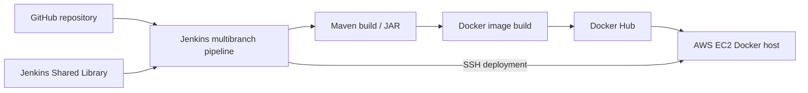

# Jenkins CI/CD: Java, Maven, Docker, AWS EC2 and Shared Libraries

> **Programme:** TechWorld with Nana — AI-Enhanced DevOps Bootcamp
>
> **Status:** Original source and branches reviewed; Jenkins runtime/build evidence still required.
>
> **Repository:** [asambataiden/twn-devops-bootcamp](https://github.com/asambataiden/twn-devops-bootcamp)
>
> **Default-branch code examined:** [`34d423c`](https://github.com/asambataiden/twn-devops-bootcamp/tree/34d423c01097f65149837cc216c8f15e51605aa5), 28 September 2026

## 1. Purpose

This repository records a sequence of hands-on Jenkins exercises evolving from a local Groovy pipeline and GitHub webhook experiment to reusable Jenkins Shared Libraries, Maven version automation, Docker Hub publishing, and AWS EC2 deployment.

**The seven historical branches are important separate learning artifacts.** Their presence and source code have been checked; historical Jenkins run results and cloud deployment success have **not yet been independently verified**.

## 2. Learning outcomes represented by the source

- Build and package a Java/Spring Boot application using Maven and Jenkins.
- Explore a GitHub multibranch pipeline with webhook-triggered changes.
- Extract pipeline functionality into a reusable Groovy Shared Library.
- Calculate and incorporate a Maven version into container image tags.
- Authenticate to Docker Hub using Jenkins-managed credentials.
- Publish a Docker image and deploy over SSH to an EC2 Docker host.
- Compare a direct `docker run` workflow with a Docker Compose workflow.
- Experiment with committing automated version changes to a dedicated branch.

## 3. Architecture



See [architecture and execution details](docs/architecture.md).

The current `main` Jenkinsfile defines these stages:

| Stage | Source-defined behavior | Execution condition |
|---|---|---|
| Increment Version | Maven version plugin + read project version | All branches |
| Build App | Shared Library `buildJar()` calls `mvn clean package` | All branches |
| Build and Push Image | Shared Library builds and pushes `asambataiden/demo-app`, tagged with version/build number | `main` only |
| Deploy | SSH into an EC2 Docker host, pull image, replace container | `main` only |
| Commit Version Update | Commit and push changed `pom.xml` | `commitVersionUpdate` only |

**Important:** Conditions in the `main` Jenkinsfile do not establish what the different branch Jenkinsfiles execute; each branch maintains its own file. Review the branch-specific guides below.

## 4. Source layout

| File or directory | Purpose |
|---|---|
| [`Jenkinsfile`](Jenkinsfile) | Declarative pipeline orchestration and branch gating |
| [`pom.xml`](pom.xml) | Maven build and Java/Spring dependencies |
| [`Dockerfile`](Dockerfile) | Java container image assembly |
| [`src/main/java/com/example/Application.java`](src/main/java/com/example/Application.java) | Spring Boot entrypoint and application status method |
| [`src/test/java/AppTest.java`](src/test/java/AppTest.java) | JUnit test asserting the status method returns `OK` |
| [`script.groovy`](script.groovy) | Earlier loaded Groovy helper example |
| [Shared Library repository](https://github.com/asambataiden/jenkins-shared-library) | Versioned reusable build, Docker login and push methods |

Note: `getStatus()` is tested directly in Java. The inspected application does **not** define an HTTP endpoint for this method, so do not assume `/health` or `/status` exists.

## 5. Branches and distinct use cases

| Historical branch | Distinct experiment | Technical guide |
|---|---|---|
| [`feature/webhook-test`](https://github.com/asambataiden/twn-devops-bootcamp/tree/feature/webhook-test) | Multibranch webhook / local Groovy pipeline steps | [01 · Webhook and local Groovy](docs/use-cases/01-webhook-and-local-groovy.md) |
| [`jenkins-shared-library`](https://github.com/asambataiden/twn-devops-bootcamp/tree/jenkins-shared-library) | Shared-library adoption | [02 · Shared Library](docs/use-cases/02-shared-library.md) |
| [`incrementAppVersion`](https://github.com/asambataiden/twn-devops-bootcamp/tree/incrementAppVersion) | Version increment and image naming | [03 · Maven versioning](docs/use-cases/03-maven-versioning.md) |
| [`deployToAWSDockerServer`](https://github.com/asambataiden/twn-devops-bootcamp/tree/deployToAWSDockerServer) | EC2 SSH and Docker deployment | [04 · AWS Docker deployment](docs/use-cases/04-aws-docker-deployment.md) |
| [`deployToAWSDokerServer_With_DockerCompose`](https://github.com/asambataiden/twn-devops-bootcamp/tree/deployToAWSDokerServer_With_DockerCompose) | EC2 deployment with Compose | [05 · Docker Compose](docs/use-cases/05-docker-compose-deployment.md) |
| [`commitVersionUpdate`](https://github.com/asambataiden/twn-devops-bootcamp/tree/commitVersionUpdate) | Automated version update and branch push | [06 · Version commit](docs/use-cases/06-version-commit.md) |
| [`main`](https://github.com/asambataiden/twn-devops-bootcamp/tree/main) | Integrated direct-Docker deployment version | [07 · Main integration](docs/use-cases/07-main-integration.md) |

Branch names and historic spellings are preserved exactly to avoid breaking links.

## 6. Prerequisites and reproduction

The original Jenkinsfile references a Jenkins Maven tool named `maven-3.9`, a global Shared Library named `jenkins-shared-library`, and Jenkins credential IDs for Docker Hub, GitHub and EC2 SSH. These are **configuration identifiers, not usable credentials**.

Start by checking out a specific branch and recording the actual environment:

```bash
git clone https://github.com/asambataiden/twn-devops-bootcamp.git
cd twn-devops-bootcamp
git checkout main
java -version
mvn -version
mvn -B clean verify
```

`mvn -B clean verify` is a **proposed validation command**, not a claim of an observed successful run. Actual builds and cloud deployment require your Jenkins, Docker, cloud access, approved credentials and security checks. Follow [the reproduction guide](docs/reproducibility.md).

## 7. Validation and evidence

See the [validation matrix](docs/validation.md). Currently:

- **Code inspected:** yes, from GitHub on 21 October 2026.
- **JUnit test present:** yes; the repository includes a `getStatus()` assertion.
- **Maven test execution:** not yet verified.
- **Jenkins stages:** defined in code; successful stage executions not yet independently evidenced.
- **Docker Hub publish:** configured in code; historical push result not yet verified.
- **EC2 deployment:** configured in code; historical success not yet verified.

No CI/CD success, production readiness or certification completion should be inferred from the source alone.

## 8. Security and operational considerations

Historical exercises include intentionally simplified infrastructure and security practices. In particular, the SSH deployment disables host-key verification and a Compose branch contains a literal PostgreSQL password. Never reuse those defaults for a real workload.

Read [security review](docs/security-review.md) before running or publishing the exercises and [lessons and engineering improvements](docs/lessons-learned.md) for the proposed production evolution. Original code remains unchanged in this documentation PR.

## 9. Documentation, attribution and scope

This is **retrospective documentation of personal hands-on work**, prepared for study and TWN Credly evidence. The official bootcamp materials belong to TechWorld with Nana. Descriptions are based on personally accessible source branches; actual deployment logs and personal reflections must be confirmed by the learner. Historical Git commits are preserved.

[Return to the master bootcamp portfolio](https://github.com/asambataiden/twn-devops-bootcamp-portfolio).
