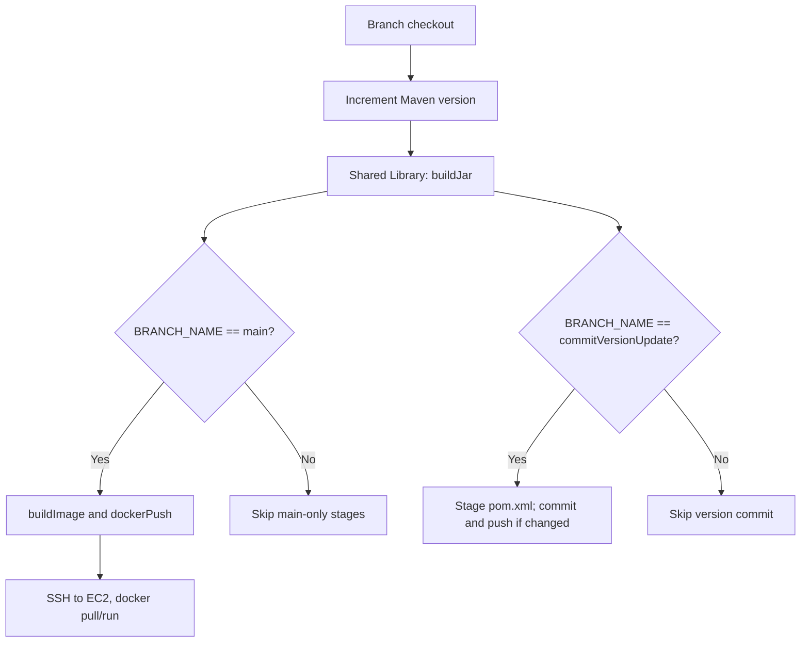

# Jenkins pipeline architecture and component boundaries

**Source snapshot:** [`main` at `34d423c`](https://github.com/asambataiden/twn-devops-bootcamp/tree/34d423c01097f65149837cc216c8f15e51605aa5). **Status:** source reviewed, runtime unverified.

## Components

| Component | Responsibility | Evidence |
|---|---|---|
| GitHub source repository | Application code, Maven POM, Jenkinsfile and feature branches | This repository |
| Jenkins multibranch job | Per-branch pipeline evaluation; build-stage orchestration | `Jenkinsfile`; webhook branch |
| Jenkins Shared Library | Reusable `buildJar`, `buildImage`, `dockerLogin` and `dockerPush` steps | [Library repository](https://github.com/asambataiden/jenkins-shared-library) |
| Maven | Changes `pom.xml` version, resolves dependencies, runs packaging | `pom.xml` and pipeline |
| Docker | Builds image from packaged JAR, authenticates/pushes image | `Dockerfile` and shared Docker helper |
| Docker Hub | Registry for `asambataiden/demo-app` | Image name in pipeline |
| AWS EC2 | SSH target executing Docker pull/run | Deploy stage; actual host intentionally omitted here |

## Declarative pipeline flow

This graph describes conditions **as written in the `main` Jenkinsfile**. Jenkins loads the Jenkinsfile belonging to the branch it builds; on the historical `commitVersionUpdate` branch, its own Jenkinsfile uses different branch conditions. This is a known integration consistency risk.

## Deployment behavior

The original EC2 deployment is *imperative*: it pulls a selected tag, removes the previous named container, and runs a replacement on port 8080. A check using `docker ps` confirms a container is running, **not** that the application is ready to serve traffic. There is no application-level health check, rolling update or rollback in this version.

The Compose exercise is a **separate branch**, not the default deployment: it copies a Compose file, creates environment configuration on EC2, validates Compose with `docker compose config --quiet`, pulls images and runs `docker compose up -d --remove-orphans`.

## Java application boundaries

The inspected code contains:

- A Spring Boot application entrypoint that logs startup.
- A `getStatus()` method returning the literal `OK`.
- A JUnit 4 test that calls the method directly.
- A Maven POM with Java 17 compiler configuration and Spring Boot 3.5.5 dependencies.

The code reviewed does **not** establish a REST readiness endpoint or a working PostgreSQL integration. The PostgreSQL container in the Compose branch should be described as a sidecar exercise service, not an application dependency that has been demonstrated.

## Production evolution (not part of original implementation)

- Immutable image digests and supply-chain scanning.
- JUnit and integration tests as deployment gates.
- Trusted SSH host keys or an SSH-replacing deployment strategy.
- Health checks with timeout and rollback behavior.
- Artifact provenance, least-privilege service accounts, and secure credentials.
- Declarative/automated infrastructure and observability.

See [security review](security-review.md).
